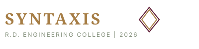

# SYNTAXIS 2026

<div align="center">



### ⚡ NCR's Premier Inter-College Tech Fest

**R.D. Engineering College (RDEC), Ghaziabad**  
**October 29 – 31, 2026**

[](https://github.com/rehaan-ahmad/syntaxis)
[](https://www.typescriptlang.org/)
[](https://react.dev/)
[](https://vite.dev/)
[](https://tailwindcss.com/)
[](LICENSE)

[Fest Portal](https://syntaxis.rdec.ac.in) · [Venue Location](https://maps.app.goo.gl/PEvYLJkc59h9BBZg7) · [Contact Committee](mailto:syntaxis@rdec.in)

</div>

---

## ✨ Overview

**Syntaxis 2026** is the flagship inter-college tech fest of R.D. Engineering College, hosted by the student developer community. Bringing together 25+ NCR colleges, 4 partnered schools, and 500–700 participants across 3 intensive days, Syntaxis showcases hackathons, competitive programming, AI exhibitions, gaming tournaments, workshops, and high-impact talks.

This repository houses the official festival web portal — a modern, single-page application built with React 19, TypeScript, Vite 8, and Tailwind CSS v4. The platform features an interactive WebGL plasma shader background, glassmorphism UI tokens, custom Framer Motion view triggers, seamless KonfHub checkout modals, native Tally registration popups, and print-ready digital consent documents.

> *"Syntaxis" — from the Greek root meaning order, arrangement, and systematic coordination.*

---

## 🏛️ Architecture & Directory Layout

```
syntaxis/
├── public/                    # Static assets & SEO files
│   ├── assets/
│   │   ├── logo/              # College crest, Syntaxis logo, Nexora banners
│   │   ├── events/            # High-res event banner graphics
│   │   ├── speakers/          # Keynote speaker profile pictures
│   │   ├── sponsors/          # Sponsor logos & partner crests
│   │   └── team/              # Organizing committee headshots
│   ├── docs/                  # Printable consent & compliance letters
│   │   ├── genesis-consent.html    # Class 9–12 parental consent
│   │   └── archithon-consent.html  # Overnight hackathon guardian consent
│   ├── favicon.svg            # Custom SVG favicon
│   ├── robots.txt             # Search crawler directives
│   └── sitemap.xml            # Canonical sitemap
├── src/
│   ├── App.tsx                # Single-page layout (Plasma + Nav + Sections + Modals + Footer)
│   ├── main.tsx               # Vite React 19 bootstrap
│   ├── index.css              # Design tokens (:root), utilities, and typography
│   ├── components/
│   │   ├── bg/                # WebGL plasma shader canvas + static mobile fallback
│   │   ├── carousel/          # Embla Carousel for responsive event browsing
│   │   ├── effects/           # Sniper reticle cursor interaction
│   │   ├── icons/             # Custom SVG icons & social branding
│   │   ├── modals/            # Legal, DPDP, Privacy, and Ticket checkout modals
│   │   ├── nav/               # Responsive notch header with smooth section scrolling
│   │   ├── ui/                # UI primitives (Card, Badge, Button, CountdownTimer, etc.)
│   │   └── Footer.tsx         # Site footer with credits, college links & quick anchors
│   ├── sections/              # 10 full-width page sections
│   │   ├── Hero.tsx           # Countdown, live status, primary CTA
│   │   ├── About.tsx          # Key metrics (colleges, prizes, footfall) & core pillars
│   │   ├── Events.tsx         # Categorized event catalog with modal checkouts
│   │   ├── GenesisTrack.tsx   # Junior track (Classes 9–12) with school registration
│   │   ├── Schedule.tsx       # 3-day timeline with tab navigation & venue locations
│   │   ├── Speakers.tsx       # Keynote speakers & panelist profiles
│   │   ├── Sponsors.tsx       # Tiered sponsorship showcase & brochure download
│   │   ├── Register.tsx       # Pricing tiers, multi-event packages, & ticketing breakdown
│   │   ├── FAQ.tsx            # Expandable FAQs (Wi-Fi, BYOD, food, rules, GMaps)
│   │   └── TeamContact.tsx    # Organizing committee & Web3Forms contact integration
│   ├── hooks/
│   │   └── useCountdown.ts    # Live countdown state to October 29, 2026
│   └── lib/
│       └── constants.ts       # Festival metadata, ticket pricing, links, schedule data
├── vite.config.ts             # Vite build config with path aliases & chunk splitting
├── tailwind.config.ts         # Tailwind CSS theme extensions
├── tsconfig.app.json          # Strict TypeScript configuration
└── package.json
```

---

## 🎨 Design System

Syntaxis 2026 features a bespoke dark-palette design system managed strictly via CSS custom properties in [`src/index.css`](src/index.css).

| CSS Variable | Value | Purpose |
|--------------|-------|---------|
| `--color-bg` | `#11100e` | Deep obsidian background |
| `--color-accent` | `#5d1c34` | Crimson wine accent |
| `--color-brand` | `#a67d45` | Warm gold hero tone |
| `--color-text-pri` | `#f0e9e3` | Ivory primary typography |
| `--color-text-sec` | `#899581` | Sage muted secondary typography |
| `--color-text-body` | `#cdbbad` | Warm parchment body copy |
| `--color-bg-glass` | `rgba(17, 16, 14, 0.80)` | Glassmorphism card fill with blur |
| `--color-accent-glow` | `rgba(93, 28, 52, 0.40)` | Crimson shadow glow |
| `--color-brand-glow` | `rgba(166, 125, 69, 0.30)` | Gold halo glow |

**Typography**:
- **Headings**: `Cinzel`, `Georgia`, serif
- **Body**: `Inter`, system-ui, sans-serif
- **Data / Timers**: `JetBrains Mono`, monospace

---

## ⚡ Tech Stack

| Layer | Technology | Usage in Syntaxis |
|---|---|---|
| **Core Framework** | React 19 | Component hierarchy, functional state, and modern hooks |
| **Language** | TypeScript 6.0 | Strict typing, interface safety across schedules and event passes |
| **Bundler & Tooling** | Vite 8 + Rollup | Fast HMR, Rollup manual chunking for optimal client caching |
| **Styling** | Tailwind CSS v4 + Vanilla CSS | CSS custom properties, utility styling, fluid clamp typography |
| **Animation Engine** | Framer Motion 12 | Scroll-triggered entrance animations & viewport transitions |
| **Graphics & Shaders** | WebGL (GLSL Plasma Shader) | Ambient background animation with GPU fallbacks |
| **Navigation** | react-scroll | Smooth single-page anchor jumping without route changes |
| **Ticketing Engine** | KonfHub API + Tally.so | Embedded modal checkout for paid passes & free event forms |
| **Contact Integration**| Web3Forms | Serverless direct-to-inbox inquiry submissions |
| **Linter** | oxlint | Blazing-fast Rust-based static code analysis |

---

## 🎟️ Hybrid Ticketing & Event Registration Architecture

Syntaxis uses a hybrid registration flow:

1. **Paid Passes (KonfHub)**: Integrated via an interactive modal (`KonfHubModal.tsx`) that embeds the checkout widget (`https://konfhub.com/widget/id/a1d6c4f0-668d-4719-a7c1-06cdb3c75012`). Transparent pricing includes the +3.75% platform fee notice.
2. **Free Events & Inquiries (Tally.so)**: Popups and embeds using official Tally form IDs:
   - **Genesis Track**: Form ID `xXeyrr` (Schools & Classes 9–12)
   - **Rhesis Speaker Sessions**: Form ID `9qz8j5`
   - **Pantheon Games (Free Fire Tournament)**: Form ID `1WPJAb`
   - **General Inquiries & Support**: Form ID `ZjBZro`

### Event Tiers & Structure

| Event / Pass | Format | Eligibility | Fee | Platform |
|---|---|---|---|---|
| **Techne (Flagship Pass)** | Solo / Team | College Students | ₹100 + ₹3.75 fee | KonfHub |
| **Contest Package** | Agon CP + Katharsis Debug | College Students | ₹200 + ₹7.50 fee | KonfHub |
| **Archithon Hackathon** | 24-Hour Overnight (Team 2–4) | College Students | ₹800 + ₹30 fee | KonfHub |
| **Genesis Track** | STEM Innovation & Robotics | Classes 9–12 (Partner Schools) | **FREE** | Tally (`xXeyrr`) |
| **Pantheon Games** | Free Fire Esports Tournament | Open (Solo & Squads) | **FREE** | Tally (`1WPJAb`) |
| **Rhesis Keynotes** | Tech Talks & Panel Discussion | All Attendees | **FREE** | Tally (`9qz8j5`) |

---

## 📄 Digital Consent & Compliance Letters

Located in [`public/docs/`](public/docs/), these standalone HTML documents can be viewed, downloaded, or printed directly by attendees, parents, and school coordinators:

1. **Genesis Track Parental Consent Letter** (`/public/docs/genesis-consent.html`):
   - Formal parental/guardian authorization for minor students (Classes 9–12).
   - Code of conduct, media release, and emergency guardian contact details.
2. **Archithon 24h Overnight Consent Letter** (`/public/docs/archithon-consent.html`):
   - College identification and overnight campus stay agreement.
   - Lab safety protocols, hardware bringing guidelines (BYOD), and participant liability waivers.

---

## 🗓️ Festival Master Schedule (Oct 29 – 31, 2026)

### Day 1: Foundation & Illumination (Thursday, Oct 29, 2026)
- **09:00 AM – 10:30 AM**: Opening Ceremony & Lamp Lighting *(Main Auditorium)*
- **10:30 AM – 01:00 PM**: Syndesis — IoT & Robotics Workshop *(Hardware Lab 3)*
- **01:00 PM – 02:00 PM**: Lunch Break & Networking
- **02:00 PM – 03:30 PM**: Logika — DSA & System Design Masterclass *(Seminar Hall A)*
- **03:30 PM – 05:00 PM**: Rhesis — Industry Keynote & Panel Discussions *(Main Auditorium)*

### Day 2: The Crucible of Code (Friday, Oct 30, 2026)
- **09:30 AM – 11:30 AM**: Heureka — Science & Tech Project Exhibition *(Central Lawn)*
- **10:00 AM (Ongoing)**: Archithon 24h — Overnight Hackathon Check-in & Kickoff *(Software Labs)*
- **11:30 AM – 01:30 PM**: Agon — Competitive Programming Arena *(Computing Center 1)*
- **01:30 PM – 02:30 PM**: Lunch Break
- **02:30 PM – 04:30 PM**: Katharsis — The Reverse Debug Duel *(Lab 2)*
- **02:30 PM – 05:30 PM**: Pantheon Games — Free Fire Esports Tournament *(E-Sports Arena)*

### Day 3: Culmination & Glory (Saturday, Oct 31, 2026)
- **09:00 AM – 01:00 PM**: Genesis Track — High School STEM Showcase *(Seminar Hall B)*
- **10:00 AM**: Archithon 24h — Code Freeze & Hackathon Submission *(Software Labs)*
- **10:30 AM – 01:00 PM**: Pythia — AI & Open-Source Project Expo *(Computing Center 2)*
- **01:00 PM – 02:00 PM**: Lunch Break
- **02:00 PM – 03:30 PM**: Eureka Pitch Finals & Archithon Live Demos *(Main Auditorium)*
- **03:30 PM – 05:00 PM**: The Tribunal & Valedictory Awards Ceremony *(Main Auditorium)*

---

## 👥 Organizing Committee

| Name | Role | Responsibilities |
|---|---|---|
| **Rehaan Ahmad** | Technical Director | Architecture, Web Platform, System Design & Infrastructure |
| **Diya Sharma** | Organizing Lead | Overall Fest Execution, Operations, Logistics & College Outreach |
| **Anurag Kumar** | Operations Director | Event Logistics, Venue Management & Sponsorship Outreach |
| **Priyanshi Garg** | Marketing Head | Digital PR, Social Channels, Campus Ambassador Program |
| **Prabhati Pandey** | Creative Head | Visual Design System, Brand Collateral & Stage Aesthetics |
| **Priya Sharma** | Documentation Head | Rules, Event Guidelines, Legal/Consent & Event Recording |
| **Palak Tyagi** | Executive Director | Cross-Department Coordination & Institutional Relations |

For corporate partnerships and stall bookings: `syntaxis@rdec.in`.

---

## 🚀 Getting Started Locally

### Prerequisites
- **Node.js**: $\ge 18.0.0$
- **npm**: $\ge 9.0.0$

### Setup Instructions

```bash
# Clone the repository
git clone https://github.com/rehaan-ahmad/syntaxis.git
cd syntaxis

# Install dependencies
npm install

# Start development server
npm run dev

# Run oxlint check
npm run lint

# Production build
npm run build

# Preview production build locally
npm run preview
```

---

## 🌐 Production Deployment

The project builds a static bundle into `dist/` configured with base path `/syntaxis/` for deployment on `syntaxis.rdec.ac.in`.

### Sample Nginx Configuration

```nginx
server {
    listen 80;
    listen [::]:80;
    server_name syntaxis.rdec.ac.in;

    root /var/www/syntaxis/dist;
    index index.html;

    # Enable gzip compression
    gzip on;
    gzip_types text/plain text/css application/json application/javascript text/xml application/xml image/svg+xml;

    location /syntaxis/ {
        alias /var/www/syntaxis/dist/;
        try_files $uri $uri/ /syntaxis/index.html;
    }

    location ~* \.(js|css|png|jpg|jpeg|gif|ico|svg|woff|woff2|ttf|eot)$ {
        expires 1y;
        add_header Cache-Control "public, immutable";
    }
}
```

---

## 📱 Accessibility & Performance Features

- **Responsive Viewports**: Responsive layout system optimized from 320px mobile up to 4K displays.
- **GPU Degradation Fallback**: Automatically disables the WebGL shader on viewports $\le 768\text{px}$ or low-end GPUs, swapping to a lightweight CSS gradient.
- **Reduced Motion**: Full support for `prefers-reduced-motion: reduce` across Framer Motion triggers.
- **BYOD Policy & Connectivity**: Clear offline/backup guidelines for participants regarding personal mobile hotspots in FAQ.
- **Interactive Geolocation**: Direct link to [RDEC Campus on Google Maps](https://maps.app.goo.gl/PEvYLJkc59h9BBZg7).
- **Privacy & Security**: Built-in modal covering the Digital Personal Data Protection (DPDP) Act 2023, IT Act, and PCI-DSS compliance via KonfHub.

---

## 📄 License

This project is **UNLICENSED** — proprietary to Rehaan Ahmad. All rights reserved.

---

<div align="center">

**Built with 🤍 by Rehaan Ahmad**  
*R.D. Engineering College, Delhi-Meerut Expressway, Ghaziabad*

</div>
