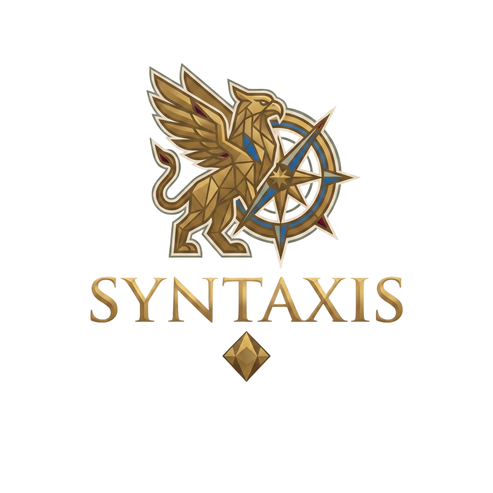

<div align="center">



# SYNTAXIS 2026
### Premier Inter-College Technical Festival

**R.D. Engineering College (RDEC), Ghaziabad**  
**October 29 – 31, 2026**

[](https://github.com/rehaan-ahmad/syntaxis)
[](https://www.typescriptlang.org/)
[](https://react.dev/)
[](https://vite.dev/)
[](https://tailwindcss.com/)
[](LICENSE)

[Official Web Portal](https://syntaxis.rdec.ac.in) • [Photo & Video Archive](https://drive.google.com/drive/folders/13Rub1wxVaKiAO7EEhOR7QL-whivDs5c1?usp=drive_link) • [Campus Location](https://maps.app.goo.gl/PEvYLJkc59h9BBZg7) • [Contact Desk](mailto:syntaxis@rdec.in)

---

</div>

## 📌 Executive Summary

**SYNTAXIS 2026** is the official technical festival of R.D. Engineering College, organized by the student community. The festival brought together students from **25+ colleges** across the National Capital Region (NCR) for three days of competitive programming, hackathons, cloud computing workshops, technology talks, and esports tournaments.

This repository holds the complete source code for the festival web platform. The application is a single-page web app built with React 19, TypeScript, Vite, and Tailwind CSS. The festival concluded on October 31, 2026, and this repository is preserved in an archived post-event state.

> **Origin:** *Syntaxis* comes from the Ancient Greek root *σύνταξις*, meaning systematic arrangement and coordination.

---

## 🏆 Official Festival Leadership & Credits

Syntaxis 2026 was organized and directed by the student committee at R.D. Engineering College:

<div align="center">

| Name | Role & Department | Primary Responsibilities |
|:---|:---|:---|
| **Rehaan Ahmad** | Fest Director | Platform Architecture, System Design, Engineering, and Directorship |
| **Diya Sharma** | Organizing Lead | Overall Fest Execution, Outreach Coordination, and Operations |
| **Anurag Kumar** | Operations Director | Campus Infrastructure, Lab Allocations, and Logistics |
| **Priyanshi Garg** | Marketing Head | Digital PR, Ambassador Network, and Media Outreach |
| **Prabhati Pandey** | Creative Head | Brand Identity, Stage Aesthetics, and Graphic Production |
| **Priya Sharma** | Documentation Head | Festival Regulations, Compliance, and Written Records |
| **Palak Tyagi** | Executive Director | Institutional Coordination and Departmental Operations |
| **Shikhar Singh** | Volunteer Head / Incharge | On-Ground Volunteer Operations and Participant Flow |

</div>

---

## 🤝 Confirmed Corporate Partners

Syntaxis 2026 was sponsored and supported by leading technology and education organizations:

| Tier | Partner Organization | Association & Activation |
|:---|:---|:---|
| **Title Sponsor** | **GeeksforGeeks** | Co-branding, Stage Recognition, and Heureka Contest Platform |
| **Co-Sponsor** | **Coding Blocks** | Secondary Stage Visibility, Workshop Partnership, and Booth Presence |
| **Associate Sponsor** | **TrueAQI** | Environmental Intelligence Track and Product Showcase |
| **Associate Sponsor** | **NovoInvent** | Software Innovation Partner and Technical Showcase |
| **Associate Sponsor** | **Gabfest** | Community Engagement and Youth Media Distribution |

---

## ⚡ Technical Architecture & Stack

```
syntaxis-portal/
├── public/                    # Production static assets
│   ├── assets/
│   │   ├── events/            # High-resolution event banners
│   │   ├── logo/              # College crest, NAAC, and Syntaxis marks
│   │   ├── sponsors/          # Verified corporate sponsor logos
│   │   └── team/              # Core committee profile images
│   ├── docs/                  # Printable participant consent documents
│   │   └── archithon-consent.html # 24-hour overnight hackathon waiver
│   └── favicon.svg
├── src/
│   ├── components/
│   │   ├── bg/FluidBg.tsx     # WebGL-inspired animated fluid canvas background
│   │   ├── carousel/          # Embla carousel for mobile event exploration
│   │   ├── effects/           # Sniper click reticle interaction
│   │   ├── nav/Navbar.tsx     # Three-slice responsive notch header
│   │   ├── ui/                # Modals, countdown, cards, badges, and alerts
│   │   │   ├── FestEndedBanner.tsx # Dynamic post-fest notification bar
│   │   │   ├── KonfHubModal.tsx    # Secure ticket checkout dialog
│   │   │   └── OrganizerModal.tsx  # Interactive "About Me" organizer dialog
│   │   └── Footer.tsx         # Site footer with credits and repo link
│   ├── sections/              # Nine full-screen layout sections
│   │   ├── Hero.tsx           # Hero showcase, post-fest CTA, and countdown
│   │   ├── About.tsx          # Key metrics, college reach, and core values
│   │   ├── Events.tsx         # Categorized event catalog with closed badges
│   │   ├── Schedule.tsx       # Three-day master operational timeline
│   │   ├── Sponsors.tsx       # Verified partner grid and lead contacts
│   │   ├── Register.tsx       # Official passes and registration state
│   │   ├── Media.tsx          # Official Google Drive media archive section
│   │   ├── FAQ.tsx            # BYOD rules, network guidance, and venue details
│   │   └── TeamContact.tsx    # Organizing committee grid and Tally contact
│   ├── hooks/                 # Real-time countdown and viewport detection
│   ├── lib/                   # Single source of truth constants and animations
│   ├── App.tsx                # Single-page layout orchestrator
│   └── index.css              # Design tokens and custom CSS properties
└── docs/
    └── archived/              # Historical planning documents
        ├── AGENTS.md          # Engineering constraints and build guidelines
        ├── Event Schedule [3-Day].md # Full chronological schedule
        ├── HANDOVER.md        # Technical handover document
        ├── SITECHANGES.md     # Implementation log
        └── Sponsorship Tiers.md # Sponsorship packages and partner data
```

### Core Technologies

| Layer | Tool / Library | Role in Syntaxis |
|:---|:---|:---|
| **Frontend Framework** | React 19 | Functional component hierarchy and hooks |
| **Language** | TypeScript 6.0 | Strict type definitions and safe data contracts |
| **Build Tooling** | Vite 8 + Rollup | Fast development HMR and manual vendor chunk splitting |
| **CSS & Design** | Tailwind CSS v4 | Utility styling and CSS custom properties |
| **Animations** | Framer Motion | Viewport scroll entrance triggers and modals |
| **In-Page Navigation** | react-scroll | Smooth single-page anchor jumping without route changes |
| **Ticketing Integration** | KonfHub API + Tally | Secure checkout modal and free registration forms |
| **Static Code Quality** | oxlint | High-speed Rust-based linting and validation |

---

## 🎨 Design System & Color Tokens

The visual style uses a custom dark obsidian palette defined in [`src/index.css`](src/index.css):

| CSS Custom Variable | Hex Code | Functional Role |
|:---|:---|:---|
| `--color-bg` | `#11100e` | Primary obsidian background |
| `--color-accent` | `#5d1c34` | Crimson wine accent for cards and highlights |
| `--color-brand` | `#a67d45` | Hero gold tone for headers and primary badges |
| `--color-text-pri` | `#f0e9e3` | Ivory primary typography |
| `--color-text-sec` | `#899581` | Sage secondary muted text |
| `--color-text-body` | `#cdbbad` | Warm parchment body copy |
| `--color-bg-glass` | `rgba(17, 16, 14, 0.80)` | Glassmorphism blur overlay fill |

---

## 🗓️ Three-Day Master Schedule Summary

The festival occurred across three days with standard hours from 08:30 AM to 05:30 PM:

- **Day 1 (Thursday, October 29, 2026):**
  - Participant check-in and credentials collection at Main Gate.
  - The Kindling (Inauguration Ceremony) on the Main Stage.
  - Techne (Google Cloud Skill Badges) hands-on workshop in DSA Lab.
  - Code Trilogy — Round 1: Heureka (DSA contest on GeeksforGeeks).
- **Day 2 (Friday, October 30, 2026):**
  - Archithon 24h Hackathon check-in and 24-hour continuous build start.
  - Code Trilogy — Round 2: Agon (HackerRank algorithmic contest).
  - Code Trilogy — Round 3: Katharsis (Pair debugging duel).
  - Rhesis keynote talks and panel discussion in Main Auditorium (02:00 PM – 04:00 PM).
  - Pantheon Games (Free Fire mobile esports tournament arena).
- **Day 3 (Saturday, October 31, 2026):**
  - Archithon code freeze and repository lock at 10:00 AM.
  - Preliminary hackathon evaluations and product demos in IT labs.
  - The Tribunal: Top finalists present to the grand jury on Main Stage.
  - Apotheosis Valedictory Ceremony and awards distribution.
  - Concluding remarks by Fest Directors Rehaan Ahmad & Diya Sharma.

For the unabridged minute-by-minute timeline, see [`docs/archived/Event Schedule [3-Day].md`](docs/archived/Event%20Schedule%20[3-Day].md).

---

## 📦 Local Development & Verification

### Prerequisites
- Node.js $\ge 18.0.0$
- npm $\ge 9.0.0$

### Setup & Build Commands

```bash
# Clone the repository
git clone https://github.com/rehaan-ahmad/syntaxis.git
cd syntaxis

# Install dependencies
npm install

# Start local development server
npm run dev

# Run oxlint static code analysis
npm run lint

# Compile production bundle
npm run build

# Preview production build locally
npm run preview
```

---

## 🚀 Production Deployment Reference

The application compiles into static files in `dist/` configured with base path `/syntaxis/` for deployment to `syntaxis.rdec.ac.in`.

### Nginx Virtual Host Configuration

```nginx
server {
    listen 80;
    listen [::]:80;
    server_name syntaxis.rdec.ac.in;

    root /var/www/syntaxis/dist;
    index index.html;

    gzip on;
    gzip_types text/plain text/css application/json application/javascript text/xml application/xml image/svg+xml;

    location /syntaxis/ {
        alias /var/www/syntaxis/dist/;
        try_files $uri $uri/ /syntaxis/index.html;
    }

    location ~* \.(js|css|png|jpg|jpeg|gif|ico|svg|webp|woff|woff2)$ {
        expires 1y;
        add_header Cache-Control "public, immutable";
    }
}
```

---

## 📜 Historical Documentation Archive

All original planning and constraint files are preserved under [`docs/archived/`](docs/archived/):

- [`docs/archived/AGENTS.md`](docs/archived/AGENTS.md) — Engineering guidelines and system constraints.
- [`docs/archived/Event Schedule [3-Day].md`](docs/archived/Event%20Schedule%20[3-Day].md) — Finalized festival schedule.
- [`docs/archived/HANDOVER.md`](docs/archived/HANDOVER.md) — Technical handover notes.
- [`docs/archived/SITECHANGES.md`](docs/archived/SITECHANGES.md) — Operational change records.
- [`docs/archived/Sponsorship Tiers.md`](docs/archived/Sponsorship%20Tiers.md) — Partner structure and confirmed sponsors.

---

## 📄 License & Attribution

This project is **UNLICENSED** (proprietary to Rehaan Ahmad & Diya Sharma). All rights reserved.

<div align="center">

**Made with 🤍 by Rehaan Ahmad & Diya Sharma**  
*R.D. Engineering College (RDEC), Delhi-Meerut Expressway, Ghaziabad, UP 201206*  
[Official Portal](https://syntaxis.rdec.ac.in) • [GitHub Repository](https://github.com/rehaan-ahmad/syntaxis)

</div>
